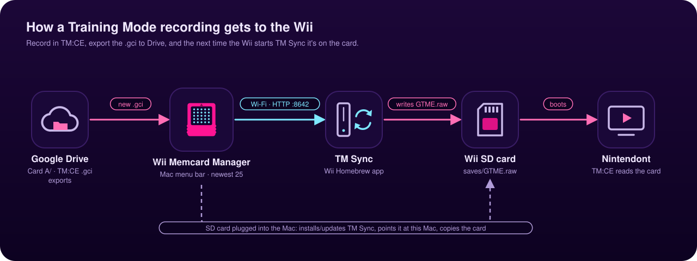

# Wii Memcard Manager

Electron + React desktop app for managing GameCube **`.gci`** files and **`.raw`** memory card images for **real Wiis** (Nintendont `saves/GTME.raw`, `GALE.raw`, etc.).

## Status

Early scaffold: folder watching (Drive / export folders), pick target `.raw`, **backup-before-write** to a `backups/` directory next to the card file. **GCMemcard merge/import logic** is not implemented yet (planned: port or call GPL Dolphin-derived code).

Agent-oriented cheat sheet (always-on Cursor rule): [`.cursor/rules/wii-memcard-manager-brief.mdc`](.cursor/rules/wii-memcard-manager-brief.mdc).

## How it fits together



## Wii TM Sync (Wi-Fi)

The app runs a small LAN server (HTTP `8642`, UDP discovery `8643`) that serves the newest staged
`GTME.raw` (251 blocks, newest 25 recordings). The companion Homebrew Channel app in
[`tm-sync/`](tm-sync/README.md) pulls it right before booting regular Nintendont (Slippi Nintendont
has no memory card emulation), only when its checksum changed, and boots normally on any failure.
The experimental [LilyGO T-Dongle firmware](https://github.com/jpfiorilla/tm-ce-dongle) speaks the
same protocol. Logs: `~/Library/Logs/Wii Memcard Manager/manager.log` (Mac) and `wii-tmsync.log`
(uploaded by TM Sync after each run).

## Develop

```bash
npm install
npm run dev
```

## Build

```bash
npm run build
```

## macOS: “damaged and can’t be opened”

Releases are **not** signed with an Apple Developer ID or notarized. macOS Gatekeeper may show that message for downloaded apps; it usually means **quarantine / unsigned**, not a bad download.

- **Remove quarantine** (after copying the app to Applications):

  ```bash
  xattr -cr "/Applications/Wii Memcard Manager.app"
  ```

- Or open **System Settings → Privacy & Security** and use **Open Anyway** when the app is blocked.
- Or **right-click** the app → **Open** → confirm once.

CI builds run an **ad-hoc** `codesign` step to reduce this; seamless installs without extra steps require **Developer ID signing + notarization** (paid Apple Developer account).

## Stack

- Electron, Vite, React, TypeScript
- MUI + Emotion, notistack
- chokidar (main process) for live folder updates

## License

MIT (boilerplate). If you embed Dolphin `GCMemcard` code, that portion is GPLv2+ — plan compliance before shipping merged logic.
